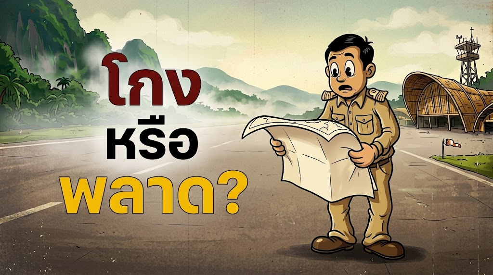

# Hanlon's Razor: เมื่อความโง่เขลาอาจทำลายชาติได้มากกว่าการโกงกิน

"ประเทศเราพังเพราะคนโกง หรือพังเพราะคนโง่แต่ขยัน?"

---

## ปริศนาสนามบินเบตง: อนุสาวรีย์สองพันล้านกลางสายหมอก

รันเวย์คอนกรีตมาตรฐานยาว 1,800 เมตร ทอดยาวท่ามกลางหุบเขาเขียวขจี อาคารผู้โดยสารสถาปัตยกรรมไม้ไผ่ที่วิจิตรงดงามระดับรางวัล และงบประมาณก่อสร้างกว่า 1,900 ล้านบาท

นี่คือ **"ท่าอากาศยานนานาชาติเบตง"** เพชรเม็ดงามที่รัฐบาลวาดหวังจะให้เป็นประตูเปิดฟ้า พลิกโฉมเศรษฐกิจและการท่องเที่ยวของสามจังหวัดชายแดนภาคใต้

ในวันเปิดตัวอย่างเป็นทางการ ผู้นำประเทศและคณะรัฐมนตรีบินไปตัดริบบิ้นเปิดเที่ยวบินปฐมฤกษ์อย่างยิ่งใหญ่ ประชาชนในพื้นที่โห่ร้องแสดงความยินดีกับอนาคตอันสดใส

ทว่าหลังจากเปิดบินได้เพียงไม่กี่เที่ยวบิน... ความจริงอันเจ็บปวดก็ปรากฏ

สายการบินพาณิชย์ทยอยยกเลิกตารางบินและพร้อมใจกันถอนตัวอย่างรวดเร็ว ปล่อยให้รันเวย์ราคาพันล้านเงียบเหงา ไร้เสียงเครื่องยนต์ และกลายสภาพเป็น "สนามบินร้างกลางสายหมอก" ที่มีเพียงเจ้าหน้าที่คอยดูแลสิ่งปลูกสร้างว่างเปล่า

ทันทีที่ข่าวแพร่ออกไป คนไทยเกือบทุกคนจะมีคำตอบสำเร็จรูปในใจทันที:

"กินหัวคิวแน่ๆ", "ฮั้วประมูลถมดิน", "สร้างมาเพื่อผลาญงบเล่น"

มันง่ายและสบายใจที่จะคิดแบบนั้น เพราะสมองมนุษย์ชอบเรื่องเล่าที่มีผู้ร้าย การมี "คนโกง" ให้ชี้หน้าด่าทำให้เรารู้สึกว่าโลกนี้เข้าใจง่าย มีขบวนการชั่วร้ายอยู่เบื้องหลังทุกความล้มเหลว

แต่ความจริงที่น่าขนลุกกว่านั้นมากคือ: **โครงการนี้ไม่มีใครโกงเลยสักบาท**

เอกสารจัดซื้อจัดจ้างถูกต้องตามระเบียบราชการ 100% เบิกจ่ายโปร่งใสทุกกระเบียดนิ้ว หน่วยงานตรวจสอบตรวจแล้วตรวจอีกก็ไม่พบการทุจริต

คำถามคือ: ถ้าไม่มีใครโกงเลย แล้วทำไมเงินภาษีเกือบสองพันล้านบาท ถึงละลายกลายเป็นความว่างเปล่าได้ขนาดนี้?

---

## สมการความพัง: Malice vs. Incompetence

คำตอบของปริศนานี้ไม่ได้อยู่ในประมวลกฎหมายอาญา แต่อยู่ในหลักคิดทางปรัชญาที่ชื่อว่า **Hanlon's Razor** ซึ่งบัญญัติไว้ว่า:

> *"อย่าด่วนสรุปว่าเป็นความมุ่งร้าย หากสิ่งนั้นสามารถอธิบายได้ด้วยความไม่รู้หรือความไร้ความสามารถ"*

มนุษย์เรามักประเมินพลังทำลายล้างของ "คนโกง" สูงเกินไป และประเมินความเสียหายของ "ความไร้ความสามารถ" ต่ำเกินไป

ถ้าลองถอดสมการความเสียหายของชาติออกมาเปรียบเทียบ เราจะเห็นภาพชัดเจน:

- **คอร์รัปชัน (Malice) = สูญเสียงบประมาณ 10–20%**
- **ตั้งโจทย์ผิด (Incompetence) = ทำลายมูลค่า 100%**

คอร์รัปชันเปรียบเหมือนการขโมยข้าวสารไปหนึ่งขัน ข้าวอาจจะแหว่งไปบ้าง แต่ส่วนที่เหลือยังหุงกินประทังชีวิตคนได้ โครงการอาจจะแพงขึ้น มีเงินทอน แต่ตัวสะพานหรือถนนยังเปิดให้ประชาชนสัญจรได้

แต่ความไม่รู้และการตั้งโจทย์ผิดแต่แรก คือการเอาน้ำยาล้างห้องน้ำมาหุงข้าว มันพังพินาศตั้งแต่ต้นทาง เสียทั้งหม้อ ข้าวสาร น้ำ ไฟ และไม่มีสิ่งมีชีวิตไหนกินได้ตั้งแต่ต้น

---

## ชำแหละสนามบินเบตง: เมื่อ "ความหวังดี" พังทลายด้วย "ความไม่เข้าใจ"

เมื่อเจาะลึกเข้าไปในรายงานความเป็นไปได้ของสนามบินเบตง เราจะพบว่านี่คือตัวอย่างระดับตำราของความล้มเหลวที่เกิดจากความไม่รู้ (Incompetence) ไม่ใช่ความชั่วร้าย:

### 1. ข้อจำกัดของรันเวย์ vs. โมเดลเครื่องบินพาณิชย์
รันเวย์ของเบตงมีความยาวเพียง 1,800 เมตร ซึ่งสั้นเกินไปสำหรับเครื่องบินไอพ่นยอดนิยมอย่าง Boeing 737 หรือ Airbus A320 ที่สายการบินโลว์คอสต์ใช้บินเป็นฝูงบินหลัก

เครื่องบินที่ลงจอดได้จึงถูกจำกัดให้เหลือเพียงเครื่องบินใบพัดขนาดเล็ก เช่น ATR-72 หรือ Q400 ซึ่งมีต้นทุนดำเนินงานต่อที่นั่ง (Seat Cost) สูงกว่ามาก สายการบินจึงไม่สามารถทำราคาตั๋วถูกๆ มากระตุ้นตลาดได้

### 2. กับดักทางกายภาพและสภาพอากาศ
ที่ตั้งของสนามบินอยู่ในแอ่งกระทะที่ล้อมรอบด้วยภูเขาสูง ทัศนวิสัยถูกปกคลุมด้วยหมอกหนาจัดเกือบตลอดทั้งปี 

การขึ้น-ลงของเครื่องบินมีความเสี่ยงสูง ต้องพึ่งพานักบินที่มีความชำนาญเฉพาะทาง และเสี่ยงต่อการยกเลิกเที่ยวบินบ่อยครั้ง ซึ่งเป็นฝันร้ายของการบริหารจัดการสายการบินพาณิชย์

### 3. การประเมินดีมานด์และราคาตั๋วที่หลุดโลก
เพื่อให้สายการบินพาณิชย์บินแล้วไม่ขาดทุน ราคาตั๋วไป-กลับ กรุงเทพฯ-เบตง จึงต้องพุ่งสูงถึง 5,000–6,000 บาท

แต่ความเป็นจริงคือ นักท่องเที่ยวทั่วไปไม่พร้อมจ่ายราคานี้ ขณะที่คนในพื้นที่ก็มีตัวเลือกในการนั่งรถตู้ไปขึ้นเครื่องที่หาดใหญ่หรือปีนังที่ค่าตั๋วถูกกว่ามาก ยิ่งเมื่อถนนทางบกได้รับการพัฒนาให้สะดวกขึ้น ตัวเลขผู้โดยสารที่เคยคาดการณ์ไว้ในรายงานจึงกลายเป็นตัวเลขในจินตนาการ

### 4. หลงทิศระหว่าง "เปลือก" กับ "แก่น" (Form ≠ Function)
รัฐบาลอยากได้ **"เศรษฐกิจและการท่องเที่ยวที่เฟื่องฟู" (Function / แก่น)** จึงคิดแบบชั้นเดียวว่าต้องสร้าง **"สนามบิน" (Form / เปลือก)**

นี่คืออาการหลงเชื่อแบบ Cargo Cult ที่คิดว่าถ้าสร้างรันเวย์ เดี๋ยวเครื่องบินและเงินทองก็บินมาลงเอง โดยไม่ได้มองบริบททางเศรษฐศาสตร์และภูมิประเทศแม้แต่น้อย

ไม่มีข้าราชการคนไหนคิดร้ายอยากให้เบตงพัง ทุกคนอยากเห็นบ้านเมืองเจริญ แต่ความไร้ความสามารถในการวิเคราะห์เชิงโครงสร้าง ได้เปลี่ยนงบประมาณ 1,900 ล้านบาท ให้กลายเป็นอนุสาวรีย์คอนกรีตที่ต้องจ่ายค่าบำรุงรักษาไปวันๆ

---

## สุสานโครงการไร้เดียงสา: ความพินาศแบบเบตงที่กระจายตัวอยู่ทั่วประเทศ

บทเรียนจากเบตงไม่ใช่เรื่องบังเอิญ แต่เป็นอาการป่วยเรื้อรังที่เกิดขึ้นซ้ำแล้วซ้ำเล่าในระบบบริหารราชการไทย:

### 1. โปรเจกต์ขายฝันระดับอภิมหาโปรเจกต์ (Megaproject Delusion)
โครงการสาธารณูปโภคขนาดใหญ่หลายแห่งมักนำเสนอตัวเลขผลตอบแทนทางเศรษฐกิจระดับแสนล้านเพื่อของบประมาณ

ในทางเศรษฐศาสตร์พฤติกรรม ปรากฏการณ์นี้ไม่ได้เกิดจากการโกงกินเสมอไป แต่อธิบายได้ด้วย **Optimism Bias** (การมองโลกในแง่ดีเกินจริงโดยไม่เจตนา) ผสมกับ **Strategic Misrepresentation** (การจงใจปั่นตัวเลขคาดการณ์ผลประโยชน์ให้สูงเว่อร์ และกดต้นทุนให้ต่ำเตี้ยเพื่อให้งบผ่าน) 

พอโครงการผ่านการอนุมัติ สร้างเสร็จแล้วเปิดใช้งานจริงไม่ได้ ก็ไม่มีใครต้องรับผิดชอบ เพราะถือว่าทำตามขั้นตอนกฎหมายครบถ้วน

### 2. แอปพลิเคชันราชการ 200 แอปฯ ที่ไม่มีใครโหลดซ้ำ
แต่ละกระทรวงต่างคนต่างจ้างทำแอปพลิเคชัน กรมละสามแอป กองละสองแอป หน้าตาโบราณ ลงทะเบียนซ้ำซ้อน และใช้งานจริงไม่ได้

ชาวบ้านก่นด่าว่าจ้างบริษัทพรรคพวกมากินหัวคิว แต่กลไกจริงคือปัญหา Silo ภายในระบบราชการ ทุกกรมต้องการตัวชี้วัด (KPI) เพื่อรายงานผู้บริหารว่า "องค์กรได้ทำ Digital Transformation แล้ว"

ทุกคนทำตามหน้าที่ของตนเองอย่างขยันขันแข็ง แต่เมื่อไม่มีใครมองภาพรวม ผลลัพธ์จึงกลายเป็นสุสานแอปพลิเคชันที่ผลาญงบเซิร์ฟเวอร์ทิ้งไปเปล่าๆ

---

## เปลือก vs. แก่น: เมื่อการปราบโกง กลายเป็นตัวแช่แข็งประเทศ

ปัญหาของสังคมไทยคือ เรามักสับสนระหว่าง **Symptom (อาการ)** กับ **Root Cause (ต้นเหตุ)**:

- **คอร์รัปชัน คือ อาการ** ที่มองเห็นง่าย มีตัวบุคคลให้ประณาม มีความสะใจในการจับคนเข้าคุก
- **การตั้งโจทย์ผิด คือ ต้นเหตุ** ที่เงียบเชียบ ไม่มีใครต้องรับผิดชอบ และสร้างความเสียหายยาวนานชั่วลูกชั่วหลาน

เมื่อสังคมเชื่อว่าปัญหาทุกอย่างเกิดจาก "คนโกง" สิ่งที่ตามมาคือการสร้างกฎระเบียบและเอกสารหนาเป็นพันหน้า (Red Tape) เพื่อหวังอุดทุกช่องโหว่

มันเปรียบเสมือน **แอปพลิเคชันที่มีระบบยืนยันตัวตน 10 ชั้น** — สแกนหน้า 3 รอบ, กรอก OTP 3 ครั้ง, แนบสำเนาทะเบียนบ้าน, บังคับอ่านข้อตกลง 40 หน้า เพื่อให้มั่นใจว่าจะไม่มีมิจฉาชีพหลุดรอดเข้าไปได้แม้แต่คนเดียว

ผลลัพธ์คือ ระบบปลอดภัยและโปร่งใส 100% แต่ผู้ใช้ท้อแท้จนกดลบแอปทิ้งตั้งแต่หน้าที่สาม ไม่มีใครได้ประโยชน์จริงสักคน

ความคลั่งไคล้ในกระบวนการตรวจสอบแบบไม่ดูผลสัมฤทธิ์ กำลังสร้างหลุมพรางร้ายแรง 3 ด้านให้กับประเทศ:

1. **กับดักขยับก็ผิด นิ่งไว้ปลอดภัยกว่า (Compliance Trap):** คนที่เดือดร้อนจากกฎระเบียบที่หยุมหยิมไม่ใช่คนทุจริต เพราะคนจะโกงย่อมหาช่องว่างทางกฎหมายได้เสมอ แต่คือข้าราชการรุ่นใหม่ไฟแรงที่อยากสร้างสิ่งใหม่ นวัตกรรมมักไม่มีระเบียบเก่ารองรับ ถ้าทำสำเร็จเสมอตัว แต่ถ้าพลาดโดนตั้งกรรมการสอบ สุดท้ายระบบจึงบีบให้ทุกคน "ไม่คิด ไม่ทำ ไม่เสี่ยง" เพื่อเอาตัวรอด
2. **มุ่งเน้น Output มากกว่า Outcome (การทุจริตเชิงประสิทธิภาพ):** ระบบสนใจแค่ว่า "ทำถูกระเบียบไหม" แต่ไม่สนว่า "ผลลัพธ์จะออกมาไร้ค่าแค่ไหน" ข้าราชการทำแอปแก้ปัญหาให้ประชาชนใช้งบ 1 ล้านบาท แต่อาจโดนสอบเรื่องจัดซื้อจัดจ้าง ในขณะที่ข้าราชการจัดสัมมนาละลายพฤติกรรมผลาญงบ 5 ล้านบาท เอกสารครบ ลายเซ็นครบ กลับผ่านฉลุย นี่คือ **Efficiency Corruption** ที่ผลาญทรัพยากรชาติอย่างถูกกฎหมาย
3. **การเปลี่ยนเครื่องมือปราบโกงเป็นอาวุธการเมือง:** กฎระเบียบป้องกันทุจริตที่ซับซ้อน มักถูกกลุ่มอำนาจเก่าใช้เป็นเครื่องมือสกัดขาคนรุ่นใหม่ที่มีผลงานโดดเด่น ใครกล้าคิดนอกกรอบจะถูกขุดคุ้ยระเบียบมาฟ้องร้องจนหมดไฟและทยอยลาออกไปในที่สุด

---

## กฎเหล็ก 50/50: ส่องโครงสร้างครึ่งหนึ่ง ตามกลิ่นเงินอีกครึ่งหนึ่ง

อย่างไรก็ตาม ในบริบทของการบริหารภาครัฐ เราจะใช้ Hanlon's Razor แบบ 100% ไม่ได้

เพราะถ้ารีบด่วนสรุปว่าทุกความล้มเหลว "เกิดจากความไม่รู้ล้วนๆ" เราจะกลายเป็นคนไร้เดียงสา (Naive) และตกเป็นเหยื่อของการทุจริตเชิงนโยบายที่ซ่อนอยู่หลังความซื่อบื้อ

สูตรสำเร็จในการมองความล้มเหลวของโครงการรัฐ คือ **กฎ 50/50**:

$$\text{Lens} = [50\%\ \text{Hanlon's Razor}] + [50\%\ \text{Follow the Money}]$$

- **50% แรก (Hanlon's Razor):** ส่องดูความไร้ประสิทธิภาพเชิงโครงสร้าง แรงจูงใจที่บิดเบี้ยว และความรู้ไม่ถึงของผู้บริหารก่อนเสมอ
- **50% หลัง (Follow the Money):** แกะรอยเส้นทางการเงินอย่างไม่ลดละ เพื่อดูว่ามีกลุ่มผลประโยชน์หรือเจตนาร้ายแอบแฝงอยู่เบื้องหลังหรือไม่

---

## ทางออก: หยุดตรวจแค่ใบเสร็จ แล้วเริ่มคัดกรองสมอง

หากเราต้องการหยุดโศกนาฏกรรมแบบสนามบินเบตงไม่ให้เกิดขึ้นซ้ำอีก เราต้องปฏิรูปกลไกในการตัดสินใจของชาติ:

### 1) โฟกัสสิ่งที่ควบคุมได้: แผนที่ดีสำคัญกว่าการพยายามปิดรอยรั่ว 100%
ความโลภเป็นธรรมชาติของมนุษย์ที่เราควบคุมไม่ได้ 100% ไม่ว่ากฎจะแน่นหนาแค่ไหน คนจะโกงย่อมหาทางเลี่ยงได้เสมอ

แต่สิ่งที่เราควบคุมได้เต็มที่ คือ **การตั้งโจทย์ที่แม่นยำ แผนงานที่เฉียบคม และการสร้างคุณค่าที่แท้จริง**
โครงการที่วางแผนถูกต้องและยกระดับเศรษฐกิจได้จริง ต่อให้มีรอยรั่ว 5% ชาติก็ยังได้ประโยชน์มหาศาล แต่โครงการที่ตั้งโจทย์ผิดแต่แรก ต่อให้ไร้การโกงกิน 100% ชาติก็ไม่ได้อะไรเลยนอกจากซากปรักหักพัง

### 2) เปลี่ยนจาก Compliance Audit เป็น Outcome Audit
เลิกวัดผลแค่ "เบิกเงินถูกระเบียบและเอกสารครบไหม" ให้เปลี่ยนมาตรวจวัดที่ "ผลสัมฤทธิ์จริง (Utility & Impact)"
ถ้าสร้างสนามบินแล้วไม่มีเที่ยวบินพาณิชย์มาลง หรือสร้างแอปแล้วไม่มีคนโหลด คณะกรรมการศึกษาความเป็นไปได้และผู้อนุมัติโครงการต้องมีส่วนรับผิดชอบต่อต้นทุนค่าเสียโอกาส

### 3) สร้าง Public Sector Regulatory Sandbox
เปิดพื้นที่ปลอดภัยทางกฎหมายให้ข้าราชการรุ่นใหม่สามารถทดลองนวัตกรรมและเทคโนโลยีใหม่ๆ ได้ โดยได้รับการยกเว้นกฎระเบียบจัดซื้อจัดจ้างแบบโบราณในช่วงเวลาที่กำหนด เพื่อคืนความกล้าคิดกล้าทำและหยุดวงจรอัมพาตของระบบราชการ

### 4) บังคับทำ Pre-Mortem ตรวจสอบ Strategic Misrepresentation
ก่อนงบประมาณระดับพันล้านจะผ่าน ให้ตั้งคณะทำงานอิสระ (Red Team) ชำแหละตัวเลขผลตอบแทนที่ผู้เสนอโครงการอ้าง สวมบทบาทว่า "หากโครงการนี้สร้างเสร็จแล้วเจ๊งสนิทในอีก 5 ปีข้างหน้า มันจะเจ๊งเพราะอะไร?" เพื่อถอดอคติและความโลกสวยของหน่วยงานเจ้าของโครงการออกให้หมด

---

## สรุป

ในระดับชีวิตประจำวัน เมื่อเพื่อนร่วมงานส่งงานช้า เจ้านายสั่งงานขัดแย้ง หรือคนขับรถปาดหน้าเรา
อย่าเพิ่งรีบด่วนสรุปว่าเขามีเจตนาชั่วร้ายกลั่นแกล้งคุณ เพราะส่วนใหญ่แล้ว... เขาแค่กำลังลนลาน มึนงง หรือไม่ได้คิดอะไรเลย

และในระดับประเทศ การมัวแต่เสียเวลาสร้างแอปยืนยันตัวตน 10 ชั้นเพื่อไล่จับคนโกง 1% จนทำให้คนทำงานอีก 99% เป็นอัมพาต จะไม่มีวันพาประเทศไปข้างหน้า

การโกงกินสร้างความเสียหายต่อเงินในกระเป๋าของชาติ
แต่การตั้งโจทย์ผิดและระบบราชการที่ไร้ความสามารถ กำลังทำลายอนาคตและโอกาสของคนทั้งรุ่น

เพราะสิ่งที่น่ากลัวที่สุดไม่ใช่ข้าราชการที่แอบเอาเงินทอนเข้ากระเป๋า
**แต่มันคือข้าราชการที่ซื่อสัตย์ ขยันขันแข็ง แต่กำลังสร้างความพินาศให้ประเทศอย่างถูกต้องตามระเบียบราชการทุกประการ**
